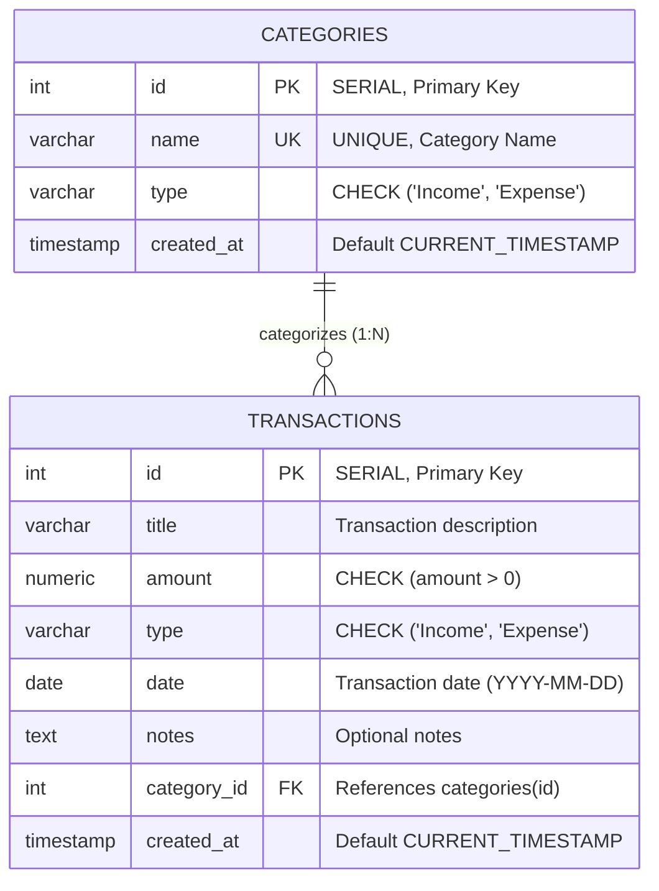

# SpendWise Database Documentation – Transactions Table

**Module:** Transaction Management (Member 1)  
**Coordination:** Developed in coordination with Member 3 (Categories Module)  
**Database System:** PostgreSQL / Prisma ORM  

---

## 1. Overview & Objectives

In SpendWise, the **Transactions** table is the foundational operational entity. Every financial movement made by the user—whether an earning (Income) or an expenditure (Expense)—is recorded as a row in this table.

The primary database design objectives are:
1. **Data Accuracy & Precision:** Monetary amounts are stored using fixed-point `NUMERIC(12, 2)` to eliminate floating-point rounding inaccuracies common in personal finance applications.
2. **Referential Integrity:** Enforce a strict foreign key relationship between `transactions` and `categories`. Transactions cannot reference non-existent categories, and active categories cannot be accidentally dropped while transactions link to them (`ON DELETE RESTRICT`).
3. **Data Integrity via Constraints:** Table-level `CHECK` and column-level `NOT NULL` constraints protect against negative or zero amounts, invalid transaction types, and blank titles.
4. **Query Performance:** High-selectivity indexes on `date`, `type`, and `category_id` ensure that monthly reports, dashboard totals, and filtered views respond quickly even as the transaction count grows.

---

## 2. Entity-Relationship (ER) Diagram



### Relationship Explanation:
- **One-to-Many (1:N):** One `Category` can have zero, one, or many `Transactions`.
- Each `Transaction` must belong to exactly **one** `Category`.
- The relationship is implemented via the foreign key column `transactions.category_id` referencing `categories.id`.

---

## 3. Data Dictionary: `transactions` Table

| Column Name | SQL Data Type | Nullable | Key / Constraint | Description |
| :--- | :--- | :---: | :--- | :--- |
| `id` | `SERIAL` (`INTEGER`) | **NO** | `PRIMARY KEY` | Auto-incrementing unique identifier for each transaction. |
| `title` | `VARCHAR(150)` | **NO** | `chk_transaction_title_not_empty` | User-entered description (e.g. "Monthly Salary", "Grocery Run"). Cannot be empty string. |
| `amount` | `NUMERIC(12, 2)` | **NO** | `chk_transaction_amount_positive` | Transaction value in currency units. Must be strictly greater than 0. |
| `type` | `VARCHAR(10)` | **NO** | `chk_transaction_type` | Nature of transaction. Allowed values: `'Income'` or `'Expense'`. |
| `date` | `DATE` | **NO** | Standard ISO Date | Date when transaction occurred (`YYYY-MM-DD`). |
| `notes` | `TEXT` | YES | Optional | Additional details, memos, or remarks by the user. |
| `category_id` | `INTEGER` | **NO** | `FOREIGN KEY` -> `categories(id)` | References the parent category. `ON DELETE RESTRICT`, `ON UPDATE CASCADE`. |
| `created_at` | `TIMESTAMP WITH TIME ZONE` | **NO** | `DEFAULT CURRENT_TIMESTAMP` | System timestamp when record was inserted. |

---

## 4. Constraint Specifications & Rationale

| Constraint Name | Constraint Type | SQL Definition | Design Rationale |
| :--- | :--- | :--- | :--- |
| `pk_transactions` | Primary Key | `PRIMARY KEY (id)` | Ensures entity integrity; every transaction is uniquely identifiable. |
| `fk_transactions_category` | Foreign Key | `FOREIGN KEY (category_id) REFERENCES categories(id) ON DELETE RESTRICT ON UPDATE CASCADE` | Preserves referential integrity. Prevents orphan transactions if a category is deleted. |
| `chk_transaction_amount_positive` | Check Constraint | `CHECK (amount > 0)` | Disallows negative numbers and zero amounts. A negative expense or income is mathematically invalid for accounting entry. |
| `chk_transaction_type` | Check Constraint | `CHECK (type IN ('Income', 'Expense'))` | Restricts transaction classification to two valid states, preventing typos like `'borrow'` or `'refund'`. |
| `chk_transaction_title_not_empty` | Check Constraint | `CHECK (LENGTH(TRIM(title)) > 0)` | Prevents accidental submission of empty or whitespace-only titles. |

---

## 5. Indexing Strategy

In desktop personal finance apps, the `transactions` table is read frequently for charts, balance calculation, and monthly reports. The following B-Tree indexes are defined:

1. `idx_transactions_date`:
   - **Column:** `date DESC`
   - **Reason:** Chronological ordering is the default view. Speeds up range scans such as `WHERE date >= '2026-11-01' AND date <= '2026-11-30'`.
2. `idx_transactions_type`:
   - **Column:** `type`
   - **Reason:** Accelerates queries filtering exclusively by `'Income'` or `'Expense'`.
3. `idx_transactions_category_id`:
   - **Column:** `category_id`
   - **Reason:** Speeds up foreign key `JOIN` operations and category-wise spending aggregations (`GROUP BY category_id`).
4. `idx_transactions_date_type`:
   - **Composite Index:** `(date DESC, type)`
   - **Reason:** Optimizes composite filtering, e.g. calculating total monthly expenses in report generation.

---

## 6. Normalization Analysis

### First Normal Form (1NF)
- All columns contain atomic, indivisible values.
- No repeating groups or multivalued arrays.
- Each row has a unique primary key (`id`).

### Second Normal Form (2NF)
- The table is in 1NF.
- The primary key consists of a single attribute (`id`). Therefore, no partial dependencies can exist. All non-key attributes (`title`, `amount`, `type`, `date`, `notes`, `category_id`) are fully functionally dependent on `id`.

### Third Normal Form (3NF)
- The table is in 2NF.
- No transitive dependencies exist.
- Notice that category details (`name`, `category_type`) are **not** stored redundantly in the `transactions` table. Instead, only `category_id` is stored. To obtain the category name, an `INNER JOIN` with `categories` is executed. This eliminates update anomalies and data duplication.

---

## 7. Prisma Schema Mapping

In `prisma/schema.prisma`, the table maps to the following Prisma model:

```prisma
model Transaction {
  id         Int      @id @default(autoincrement())
  title      String
  amount     Float
  type       String   // "Income" or "Expense"
  date       String   // Format: "YYYY-MM-DD"
  notes      String?
  categoryId Int
  category   Category @relation(fields: [categoryId], references: [id], onDelete: Restrict, onUpdate: Cascade)
  createdAt  DateTime @default(now())

  @@index([date(sort: Desc)])
  @@index([type])
  @@index([categoryId])
}
```

---

## 8. College Viva & Lab Evaluation Questions

1. **Q: Why did you choose `NUMERIC(12, 2)` instead of `FLOAT` or `REAL` for the amount?**
   - **Answer:** `FLOAT` and `DOUBLE PRECISION` use binary floating-point representation (IEEE 754), which causes precision errors during rounding and addition (e.g., $0.1 + 0.2 \neq 0.3$). `NUMERIC(12, 2)` stores exact fixed-point decimals, which is mandatory in financial and accounting applications.

2. **Q: What is the purpose of `ON DELETE RESTRICT` on the foreign key?**
   - **Answer:** If a user attempts to delete a category (e.g. "Groceries") that already has 20 transactions linked to it, `ON DELETE RESTRICT` halts the deletion and throws a foreign key violation error. This prevents "orphan" transactions whose category cannot be identified.

3. **Q: How does the application enforce that an amount cannot be negative?**
   - **Answer:** Data validation is implemented in two layers:
     - **Application level (Express.js controller):** Validates `amount > 0` before making a database call, returning HTTP `400 Bad Request`.
     - **Database level (PostgreSQL):** A `CHECK (amount > 0)` constraint guarantees that even if a direct SQL injection or manual query bypasses the backend, the database rejects negative entries.

4. **Q: How does the system compute total balance?**
   - **Answer:** Using a conditional SQL aggregation:
     ```sql
     SELECT COALESCE(SUM(CASE WHEN type = 'Income' THEN amount ELSE -amount END), 0) AS current_balance
     FROM transactions;
     ```
     This subtracts expenses from incomes in a single database pass.

