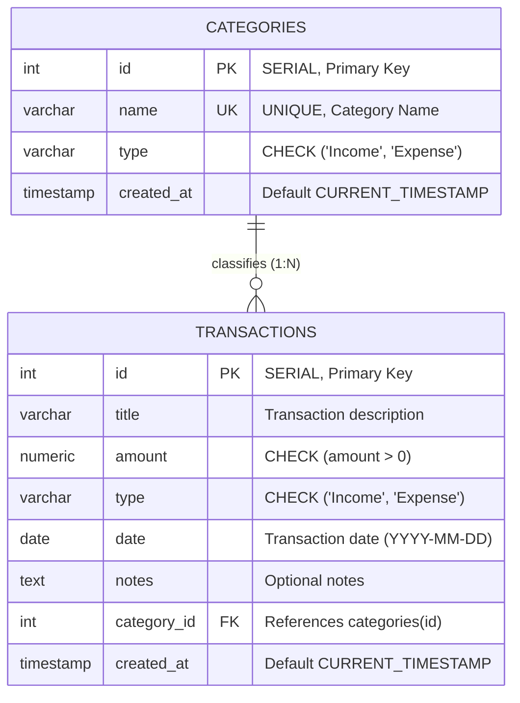

# SpendWise – Categories & Transaction History Module Documentation

**Author / Module Owner:** Member 3  
**Module:** Categories & Transaction History  
**Application:** SpendWise (Offline-first Personal Finance Desktop Application)  
**Technology Stack:** React, JavaScript, Node.js, Express.js, PostgreSQL, Prisma ORM  

---

## 1. Module Overview & Responsibilities

The **Categories & Transaction History Module** provides the core classification taxonomy and chronological auditing capabilities in SpendWise.

### Core Objectives:
1. **Category Management:** Full CRUD interface and APIs allowing the user to create, view, edit, and safely delete income and expense categories.
2. **Transaction History & Ledger:** Comprehensive chronological log of all personal financial transactions with multi-parameter filtering (by type, category, month, year) and title keyword search.
3. **Referential Integrity Enforcement:** Protecting database integrity by preventing category deletions that would orphan transaction records (`ON DELETE RESTRICT`).
4. **Relational Database Design:** Structuring data in Third Normal Form (3NF) to eliminate data redundancy and modification anomalies.

---

## 2. Categories Table Design & Data Dictionary

The `categories` table stores all predefined and custom transaction classifications.

### 2.1 Table Schema: `categories`
| Column Name | Data Type | Nullable | Constraints & Keys | Description |
| :--- | :--- | :---: | :--- | :--- |
| `id` | `SERIAL` (`INTEGER`) | **NO** | `PRIMARY KEY` | Auto-incrementing unique identifier. |
| `name` | `VARCHAR(50)` | **NO** | `UNIQUE`, `chk_category_name_not_empty` | Category name (e.g. "Food", "Salary"). Cannot be empty. |
| `type` | `VARCHAR(10)` | **NO** | `CHECK (type IN ('Income', 'Expense'))` | Category classification. |
| `created_at` | `TIMESTAMP WITH TIME ZONE` | **NO** | `DEFAULT CURRENT_TIMESTAMP` | System creation timestamp. |

### 2.2 Default Categories (Member 3 Specification)
- **Expense Categories:**
  1. Food
  2. Travel
  3. Shopping
  4. Education
  5. Entertainment
  6. Healthcare
  7. Bills
  8. Others
- **Income Categories:**
  1. Salary
  2. Freelance
  3. Business
  4. Other Income

---

## 3. Relational Architecture & Normalization

### 3.1 Entity-Relationship (1:N Relationship)



- **Relationship Cardinality:** One `Category` can be associated with zero, one, or many `Transactions`. Each `Transaction` must strictly reference exactly **one** `Category`.
- **Foreign Key Constraint:**
  ```sql
  CONSTRAINT fk_transactions_category
      FOREIGN KEY (category_id)
      REFERENCES categories(id)
      ON DELETE RESTRICT
      ON UPDATE CASCADE;
  ```
- **Referential Integrity Enforcement:**
  - `ON DELETE RESTRICT`: If a user attempts to delete a category that still has associated transactions, the database engine (PostgreSQL) and the Express controller reject the operation with a `400 Bad Request` error.
  - This guarantees that no transaction is ever left without a valid category classification.

### 3.2 Database Normalization Analysis
1. **First Normal Form (1NF):**
   - All columns contain atomic, indivisible scalar values.
   - No repeating groups or comma-separated lists of tags.
   - Primary key (`id`) uniquely identifies each row.
2. **Second Normal Form (2NF):**
   - The table is in 1NF.
   - The primary key is a single attribute (`id`). Therefore, no partial functional dependencies can exist; all non-key attributes (`name`, `type`, `created_at`) are fully functionally dependent on `id`.
3. **Third Normal Form (3NF):**
   - The table is in 2NF.
   - There are no transitive functional dependencies ($X \to Y \to Z$).
   - If category information were stored directly inside the `transactions` table, renaming a category from "Bills" to "Utilities" would require updating thousands of transaction rows. Storing categories in a dedicated table guarantees that category updates happen in exactly one place (eliminating Update Anomalies).

---

## 4. REST API Documentation

### 4.1 Category Management APIs

#### 1. `GET /api/categories`
- **Query Parameters (Optional):** `?type=Income` or `?type=Expense`
- **Response (200 OK):**
```json
{
  "success": true,
  "count": 12,
  "data": [
    { "id": 1, "name": "Salary", "type": "Income" },
    { "id": 2, "name": "Freelance", "type": "Income" },
    { "id": 7, "name": "Food", "type": "Expense" }
  ]
}
```

#### 2. `POST /api/categories`
- **Request Body:**
```json
{
  "name": "Gym & Fitness",
  "type": "Expense"
}
```
- **Validation:**
  - `name`: Required, trimmed, max 50 characters, must not already exist (case-insensitive duplicate check).
  - `type`: Must be strictly `'Income'` or `'Expense'`.
- **Response (201 Created):**
```json
{
  "success": true,
  "message": "Category created successfully.",
  "data": { "id": 15, "name": "Gym & Fitness", "type": "Expense" }
}
```

#### 3. `PUT /api/categories/:id`
- **Request Body:** `{ "name": "Fitness & Health" }`
- **Response (200 OK):** Returns updated category and synchronizes associated transactions.

#### 4. `DELETE /api/categories/:id`
- **Validation:** Verifies that no transactions reference this category.
- **When Linked Transactions Exist (400 Bad Request):**
```json
{
  "success": false,
  "error": "Cannot delete category 'Food' because it is linked to 4 transaction(s). Please reassign or delete those transactions first."
}
```
- **When No Transactions Are Linked (200 OK):**
```json
{
  "success": true,
  "message": "Category 'Fitness & Health' deleted successfully."
}
```

---

### 4.2 Shared Transaction History API

#### `GET /api/transactions`
Supports multi-criteria querying for the Transaction History page:
- **`type`**: `'Income'` or `'Expense'`
- **`categoryId`**: integer category ID
- **`month`**: integer between `1` and `12`
- **`year`**: integer (e.g. `2026`)
- **`search`**: text search against title or notes

---

## 5. Frontend React Components

1. **`CategoryManager.jsx`:**
   - Visual category management dashboard.
   - Tab pills to filter by 'All', 'Expense', or 'Income'.
   - Quick search input to find categories.
   - Category cards with color dots, type badges, transaction counts, and Edit / Delete actions.
   - Modal dialog for adding and editing categories.
   - Deletion safety warning modal if a user attempts to delete a category in use.

2. **`TransactionHistoryView.jsx`:**
   - Complete ledger view with search and multi-parameter filtering toolbar (Type, Category, Month, Year).
   - Dynamic counter badge (`Showing X of Y transactions`).
   - Transaction list with clear badges, date formatting, and Edit/Delete integration.
   - Clean empty state with "Reset Filters" action.

---

## 6. Viva Demonstration Guide & Questions

### Q1: What is referential integrity and how did you enforce it?
**Answer:** Referential integrity guarantees that relationships between tables remain valid. We enforce this at two levels:
1. **Database Level:** The foreign key `transactions.category_id` references `categories.id` with `ON DELETE RESTRICT`. PostgreSQL will physically reject any deletion of a category referenced in `transactions`.
2. **Application Level:** The Express `deleteCategory` controller queries the `transactions` table first. If any linked transactions exist, it immediately returns a user-friendly `400 Bad Request` error explaining how many transactions are linked and advising the user to reassign them first.

### Q2: Why did you separate Categories into its own table instead of storing a string in Transactions?
**Answer:** To adhere to Third Normal Form (3NF). Storing a raw category string in `transactions` causes:
- **Redundancy:** Repeating `"Entertainment"` across hundreds of rows wastes storage.
- **Update Anomalies:** Renaming a category requires updating every single transaction row. If one fails, data becomes inconsistent.
- **Deletion Anomalies:** Deleting transactions could erase all knowledge of a valid category.

### Q3: How does the category filter on Transaction History work?
**Answer:** The frontend sends `GET /api/transactions?categoryId=7` (or `?category=Food`). The Express controller checks the query parameter and applies `where: { categoryId: 7 }` to the database query. It also supports simultaneous filtering by month, year, type, and keyword search.
