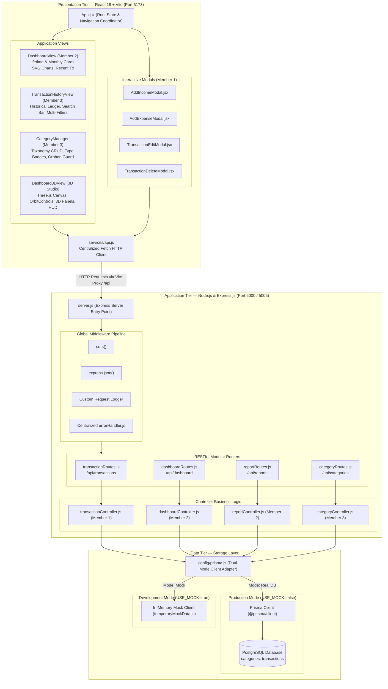
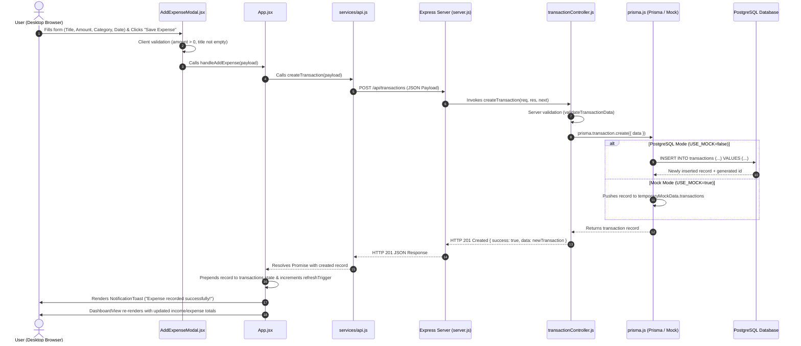

# SpendWise — System Architecture & Design Manual

## 1. Architectural Philosophy

**SpendWise** is built upon a clean, decoupled **Three-Tier Architecture** adhering to the principles of separation of concerns, high cohesion, and low coupling.

The three primary tiers are:
1. **Presentation Tier (Client)**: A desktop-optimized Single Page Application (SPA) developed with **React 18** and bundled with **Vite**, featuring both 2D SVG charting and a 3D WebGL scene rendered via **Three.js** and **React Three Fiber**.
2. **Application Tier (Server)**: A modular **Express.js (Node.js)** RESTful backend providing request routing, parameter validation, business logic, financial computation, and centralized error handling.
3. **Data Tier (Storage)**: An ACID-compliant **PostgreSQL** relational database accessed via **Prisma ORM**, complemented by an in-memory mock data adapter for zero-dependency local testing.

---

## 2. High-Level Architecture Diagram



---

## 3. Tier-by-Tier Technical Breakdown

### 3.1 Presentation Tier (Frontend)

- **Engine**: React 18 using functional components, standard hooks (`useState`, `useEffect`, `useCallback`, `useMemo`), and pure CSS variables.
- **Port**: `http://localhost:5173`.
- **Proxy Configuration**: `frontend/vite.config.js` mounts an active proxy rule redirecting all requests beginning with `/api` to the backend Express server, eliminating browser Cross-Origin Resource Sharing (CORS) blocks during development.
- **State Flow**:
  - `App.jsx` serves as the top-level state holder, loading transactions and categories concurrently via `Promise.all([getTransactions(), getCategories()])`.
  - Transient operations (e.g. creating an expense or updating a category) trigger incremental `refreshTrigger` state updates, prompting `DashboardView` to automatically reload analytical metrics without requiring a full browser refresh.
- **Service Layer (`frontend/src/services/api.js`)**: Encapsulates all browser `fetch` calls, converting HTTP response statuses and JSON payloads into clean, asynchronous JavaScript return objects or catching and formatting meaningful error messages.

### 3.2 Application Tier (Backend)

- **Engine**: Node.js with Express.js utilizing CommonJS (`require` / `module.exports`) syntax.
- **Port**: `http://localhost:5000` (or `PORT` configured in `.env`).
- **Middleware Flow**:
  1. `cors()`: Permits cross-origin resource sharing.
  2. `express.json()`: Parses incoming JSON request payloads into `req.body`.
  3. Custom Request Logger: Logs timestamps, HTTP methods, and requested URLs to the server console.
  4. Modular Route Dispatchers: Mounts routes under `/api/transactions`, `/api/dashboard`, `/api/reports`, and `/api/categories`.
  5. 404 Route Catcher: Catches undefined endpoints returning a clean JSON error.
  6. `errorHandler.js`: Intercepts unhandled synchronous and asynchronous controller errors, providing clean HTTP 500/400 JSON responses.

### 3.3 Data Tier (Dual-Mode Database Adapter)

A standout architectural design in SpendWise is the **Dual-Mode Data Layer** managed in `backend/config/prisma.js`:

```javascript
const useMock = process.env.USE_MOCK === 'true';

if (!useMock) {
  try {
    const { PrismaClient } = require('@prisma/client');
    prisma = new PrismaClient();
  } catch (error) {
    prisma = createMockPrismaClient();
  }
} else {
  prisma = createMockPrismaClient();
}
```

- **In-Memory Mock Mode (`USE_MOCK=true`)**: Emulates Prisma Client methods (`findMany`, `findUnique`, `findFirst`, `create`, `update`, `delete`, `updateMany`, `count`) over JavaScript arrays in `temporaryMockData.js`. Supports filtering by date ranges, type, category ID, and sorting. This enables developers, grading examiners, and students to evaluate the application without setting up PostgreSQL.
- **PostgreSQL Mode (`USE_MOCK=false`)**: Initializes the standard compiled `@prisma/client`, executing real SQL queries against the local or remote PostgreSQL instance.

---

## 4. End-to-End Request Sequence Flow

The following sequence diagram demonstrates the lifecycle of a user creating a new transaction:



---

## 5. Software Design Patterns Applied

1. **Model-View-Controller (MVC)**:
   - **Model**: `prisma/schema.prisma` & `backend/data/temporaryMockData.js`.
   - **View**: React components (`DashboardView`, `TransactionHistoryView`, `CategoryManager`, `Dashboard3DView`).
   - **Controller**: Express controller functions in `backend/controllers/`.
2. **Adapter Pattern**:
   - `backend/config/prisma.js` implements an in-memory adapter implementing the exact same query interface as Prisma Client, decoupling controllers from the physical database engine.
3. **Service Layer Pattern**:
   - `frontend/src/services/api.js` decouples UI presentation components from direct HTTP networking, centralizing fetch calls, headers, and response parsing.
4. **Observer / Reactive State Pattern**:
   - React state hooks (`useState`, `useEffect`, `useCallback`) propagate state changes across child components, automatically recalculating charts, KPI cards, and transaction ledger rows.
