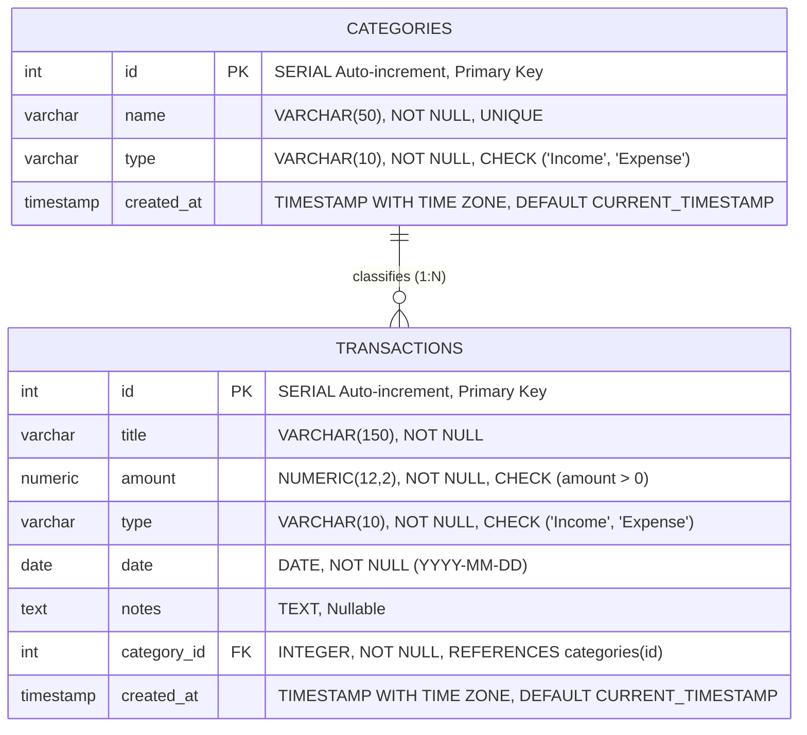

# SpendWise — Database Design, Schema & Normalization Analysis

## 1. Overview & DBMS Objectives

The SpendWise database tier is engineered as an ACID-compliant relational schema implemented in **PostgreSQL** and modeled declaratively through **Prisma ORM**. The database is designed for high relational integrity, zero data anomalies, optimized indexing, and strict enforcement of financial accounting constraints.

The database architecture is collaboratively shared between:
- **Member 1 (Transaction Management)**: Designing the `transactions` table, foreign keys, indexes, and CRUD SQL queries.
- **Member 3 (Categories & History)**: Designing the `categories` taxonomy table, uniqueness rules, 3NF normalization, and referential integrity guards.
- **Member 2 (Dashboard & Analytics)**: Querying the relational schema via aggregate functions (`SUM`, `COUNT`), grouping, and window functions.

---

## 2. Entity-Relationship (ER) Diagram



---

## 3. Data Dictionary

### 3.1 `categories` Table
The `categories` table stores all system-predefined and user-customized transaction classifications.

| Column Name | Data Type | Nullable | Key / Constraint | Description |
| :--- | :--- | :---: | :--- | :--- |
| `id` | `SERIAL` (`INT4`) | **NO** | `PRIMARY KEY`, Auto-increment | Unique identifier for each category record. |
| `name` | `VARCHAR(50)` | **NO** | `UNIQUE`, `chk_category_name_not_empty` | User-visible category title (e.g., "Food", "Salary"). Cannot be whitespace only. |
| `type` | `VARCHAR(10)` | **NO** | `chk_category_type` | Must be strictly `'Income'` or `'Expense'`. |
| `created_at` | `TIMESTAMPTZ` | **NO** | `DEFAULT CURRENT_TIMESTAMP` | System audit creation timestamp. |

#### Constraints on `categories`:
1. `PRIMARY KEY (id)`: Guarantees unique entity identification.
2. `UNIQUE (name)`: Enforces that no two categories share the same name (case-insensitive checks also enforced in application logic).
3. `CONSTRAINT chk_category_type CHECK (type IN ('Income', 'Expense'))`: Prohibits undefined or illegal financial categories.
4. `CONSTRAINT chk_category_name_not_empty CHECK (LENGTH(TRIM(name)) > 0)`: Prohibits empty or whitespace-only category titles.

---

### 3.2 `transactions` Table
The `transactions` table contains every financial earning or expenditure recorded by the user.

| Column Name | Data Type | Nullable | Key / Constraint | Description |
| :--- | :--- | :---: | :--- | :--- |
| `id` | `SERIAL` (`INT4`) | **NO** | `PRIMARY KEY`, Auto-increment | Unique identifier for each transaction record. |
| `title` | `VARCHAR(150)` | **NO** | `chk_transaction_title_not_empty` | Human-readable title/description of the transaction. |
| `amount` | `NUMERIC(12, 2)` | **NO** | `chk_transaction_amount_positive` | Exact monetary amount in currency (positive decimal). |
| `type` | `VARCHAR(10)` | **NO** | `chk_transaction_type` | Must be strictly `'Income'` or `'Expense'`. |
| `date` | `DATE` | **NO** | Valid calendar date | Date of transaction in ISO format (`YYYY-MM-DD`). |
| `notes` | `TEXT` | **YES** | None | Optional transaction notes, reference numbers, or context. |
| `category_id` | `INTEGER` | **NO** | `FOREIGN KEY → categories(id)` | Relational link to the associated parent category. |
| `created_at` | `TIMESTAMPTZ` | **NO** | `DEFAULT CURRENT_TIMESTAMP` | System audit creation timestamp. |

#### Constraints on `transactions`:
1. `PRIMARY KEY (id)`: Guarantees unique entity identification.
2. `CONSTRAINT fk_transactions_category FOREIGN KEY (category_id) REFERENCES categories(id) ON DELETE RESTRICT ON UPDATE CASCADE`:
   - `ON DELETE RESTRICT`: Prohibits raw SQL operations from deleting a category if transactions still point to it, preventing orphan records.
   - `ON UPDATE CASCADE`: Automatically cascades any update to `categories.id` down to referencing transactions.
3. `CONSTRAINT chk_transaction_amount_positive CHECK (amount > 0)`: Ensures transaction amounts are strictly positive numbers greater than zero.
4. `CONSTRAINT chk_transaction_type CHECK (type IN ('Income', 'Expense'))`: Enforces binary financial accounting typing.
5. `CONSTRAINT chk_transaction_title_not_empty CHECK (LENGTH(TRIM(title)) > 0)`: Prohibits empty transaction titles.

---

## 4. Performance Indexes

To support rapid filtering, real-time charting, and instant search over historical transaction volumes, B-tree indexes are implemented on key query targets:

```sql
-- 1. Accelerates chronological sorting and date-range monthly filtering
CREATE INDEX idx_transactions_date ON transactions(date DESC);

-- 2. Accelerates binary Income vs. Expense filtering
CREATE INDEX idx_transactions_type ON transactions(type);

-- 3. Accelerates category-wise aggregations and foreign key JOIN performance
CREATE INDEX idx_transactions_category_id ON transactions(category_id);

-- 4. Composite index optimizing simultaneous date-range and type lookups
CREATE INDEX idx_transactions_date_type ON transactions(date DESC, type);
```

| Index Name | Indexed Columns | Justification & Query Use-Case |
| :--- | :--- | :--- |
| `idx_transactions_date` | `date DESC` | Used by `/api/transactions` and `/api/dashboard` to sort by latest records first. |
| `idx_transactions_type` | `type` | Used when filtering `/api/reports/category-wise?type=Expense`. |
| `idx_transactions_category_id` | `category_id` | Crucial for `JOIN` performance between `transactions` and `categories`. |
| `idx_transactions_date_type` | `date DESC, type` | Powers monthly income and expense calculations for selected year/month. |

---

## 5. Normalization Formal Analysis (1NF to 3NF)

SpendWise was designed in accordance with **Third Normal Form (3NF)** rules to prevent insertion, update, and deletion anomalies.

### First Normal Form (1NF)
- **Rule**: All column values must be atomic; no repeating groups or arrays allowed.
- **SpendWise Compliance**: Every column in `categories` and `transactions` holds a single atomic scalar value (integer, string, numeric, date, timestamp). No comma-separated lists or JSON arrays are stored in fields.

### Second Normal Form (2NF)
- **Rule**: Must be in 1NF, and every non-key attribute must be fully functionally dependent on the entire primary key (no partial dependencies on composite keys).
- **SpendWise Compliance**: Both tables utilize single-column surrogate primary keys (`id`). Therefore, partial key dependencies are mathematically impossible ($X \to Y$ holds for the entire key $X = \{\text{id}\}$).

### Third Normal Form (3NF)
- **Rule**: Must be in 2NF, and no non-key attribute may be transitively dependent on the primary key ($X \to Y$ and $Y \to Z$ where $Z$ is non-key is forbidden).
- **SpendWise Compliance**:
  - In `transactions`, attributes like `title`, `amount`, `type`, `date`, `notes`, and `category_id` depend directly on `transactions.id`.
  - Category attributes like `category.name` and `category.type` are stored strictly in `categories` table rather than duplicated in `transactions`. This eliminates update anomalies (e.g., renaming a category requires updating a single tuple in `categories`).

---

## 6. Prisma ORM Schema Mapping

The Prisma schema in `prisma/schema.prisma` aligns directly with the PostgreSQL DDL:

```prisma
datasource db {
  provider = "postgresql"
  url      = env("DATABASE_URL")
}

generator client {
  provider = "prisma-client-js"
}

model Category {
  id           Int           @id @default(autoincrement())
  name         String        @unique
  type         String        // "Income" or "Expense"
  createdAt    DateTime      @default(now()) @map("created_at")
  transactions Transaction[]

  @@map("categories")
}

model Transaction {
  id         Int      @id @default(autoincrement())
  title      String
  amount     Float
  type       String   // "Income" or "Expense"
  date       String   // Format: "YYYY-MM-DD"
  notes      String?
  categoryId Int      @map("category_id")
  category   Category @relation(fields: [categoryId], references: [id], onDelete: Restrict, onUpdate: Cascade)
  createdAt  DateTime @default(now()) @map("created_at")

  @@index([date(sort: Desc)])
  @@index([type])
  @@index([categoryId])
  @@map("transactions")
}
```

---

## 7. Default Categories Reference

The seed database script (`database/sample_data.sql`) populates 14 canonical categories:

### Expense Categories
1. **Food** (ID 8)
2. **Travel** (ID 9)
3. **Shopping** (ID 10)
4. **Education** (ID 11)
5. **Entertainment** (ID 12)
6. **Healthcare** (ID 13)
7. **Bills** (ID 14)
8. **Others** (ID 15)

### Income Categories
1. **Salary** (ID 2)
2. **Freelance** (ID 3)
3. **Business** (ID 4)
4. **Other Income** (ID 5)
5. **Investment** (ID 6)
6. **Gift** (ID 7)

### Default System Fallback
- **Uncategorised** (ID 1, Expense): Protected system category acting as a fallback recipient when custom categories are deleted.
