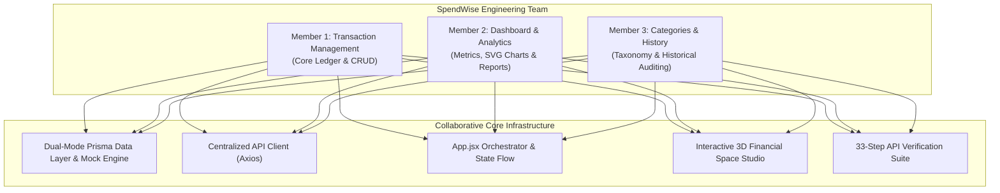

# SpendWise — Team Member Contributions & Responsibilities

This document provides a comprehensive, transparent breakdown of the division of responsibilities, individual contributions, collaborative integrations, and file ownership across the three team members for the **SpendWise** personal finance desktop application.

---

## 1. Team Structure & Module Allocation

SpendWise was architected as a modular, three-tier desktop application built by a three-member college engineering team. Each member had primary end-to-end ownership (Frontend, Backend, and Database) of an independent functional module, while collaborating on integration layers, the 3D Financial Space studio, and the unified test harness.

---

## 2. Individual Member Responsibilities & Deliverables

### Member 1: Transaction Management Module

**Core Objective:** Enable seamless, fault-tolerant recording, modification, and deletion of income and expense transactions with instant ledger feedback and notification toasts.

#### Key Deliverables:
1. **Frontend Interfaces & Modal System:**
   - `AddIncomeModal.jsx`: Modal for recording incoming cash flows with title, amount, category selector (filtered strictly for type `income`), date picker, and notes.
   - `AddExpenseModal.jsx`: Modal for recording expenditures with category selector (filtered strictly for type `expense`), validation against zero/negative amounts.
   - `TransactionEditModal.jsx`: Full-featured edit dialog pre-populating existing transaction state and updating records via `PUT /api/transactions/:id`.
   - `TransactionDeleteModal.jsx`: Destructive confirmation dialog protecting against accidental deletion via `DELETE /api/transactions/:id`.
   - `TransactionSummaryCards.jsx`: Header-level quick metric counters displaying Total Balance, Total Income, and Total Expense with dynamic color badges.
   - `NotificationToast.jsx`: Non-blocking, animated alert toast system providing visual confirmation of operation success or error states.

2. **Backend Services & Routing:**
   - `backend/controllers/transactionController.js`: Full implementation of CRUD endpoints:
     - `getAllTransactions`: Paginated/listed transactions with relational category joins and mock data fallback.
     - `getTransactionById`: Single-entity lookup by UUID or mock ID.
     - `createTransaction`: Input sanitization, numeric validation, type matching (`income` vs `expense`), date normalization.
     - `updateTransaction`: Safe field updating with category validation.
     - `deleteTransaction`: Record removal with cascade integrity.
   - `backend/routes/transactionRoutes.js`: Express router mapping HTTP verbs (`GET`, `POST`, `PUT`, `DELETE`) to transaction controller methods.

3. **Database Architecture & SQL:**
   - `backend/database/schema.sql`: Core DDL specifying tables `categories` and `transactions` with foreign key relationships, cascade behaviors, and indexes.
   - `backend/database/sample_data.sql`: Initial seed scripts populating standard transactions across realistic spending scenarios.
   - `backend/database/crud_queries.sql`: Documented SQL queries for direct database operations.
   - `backend/docs/transactions-documentation.md`: Detailed module documentation for transaction workflows.

---

### Member 2: Dashboard & Financial Analytics Module

**Core Objective:** Aggregate raw ledger data into actionable financial intelligence, computing real-time cash balances, net savings rates, monthly comparative overviews, and category spending distributions.

#### Key Deliverables:
1. **Frontend Visualizations & Analytics View:**
   - `DashboardView.jsx`: Master dashboard screen assembling summary metrics, month-over-month comparisons, visual charts, and recent activity logs.
   - `DashboardSummaryCards.jsx`: Specialized KPI cards presenting:
     - Total Balance ($B_{\text{current}} = I_{\text{total}} - E_{\text{total}}$).
     - Net Income ($I_{\text{total}}$) with transaction counters.
     - Net Expenses ($E_{\text{total}}$) with transaction counters.
     - Savings Rate percentage ($S = \frac{I - E}{I} \times 100$).
   - `CategorySpendingChart.jsx`: Custom SVG donut/pie visualization dynamically computing expense proportions, rendering interactive tooltips, and displaying color-coded category legends.
   - `MonthlyOverviewChart.jsx`: Double-bar comparative SVG chart plotting 12-month historical trends comparing monthly income against monthly expenditures.

2. **Backend Analytical Controllers & Reports:**
   - `backend/controllers/dashboardController.js`: Computes real-time dashboard KPIs (`totalIncome`, `totalExpenses`, `balance`, `recentTransactions`) from transactional data.
   - `backend/controllers/reportController.js`: Advanced aggregations:
     - `getMonthlyReport`: Computes totals and net balances for specific months or full year timelines.
     - `getCategoryReport`: Groups expenditures by category, calculating sums, transaction counts, and relative percentages.
   - `backend/routes/dashboardRoutes.js`: Exposes `/api/dashboard/summary`.
   - `backend/routes/reportRoutes.js`: Exposes `/api/reports/monthly` and `/api/reports/category`.

3. **Database Analytics & SQL:**
   - `backend/database/analytics-queries.sql`: Optimized SQL aggregation queries utilizing `SUM()`, `COUNT()`, `GROUP BY`, and `TO_CHAR(date, 'YYYY-MM')`.
   - `backend/docs/analytics-documentation.md`: Mathematical formulations and controller algorithm specifications.

---

### Member 3: Categories & Transaction History Module

**Core Objective:** Provide complete taxonomy management (customizable categories) and an exhaustive, multi-filtered historical ledger audit view with keyword search.

#### Key Deliverables:
1. **Frontend Views & Management Workflows:**
   - `CategoryManager.jsx`: Full category management interface:
     - Dynamic category grid segregated into Income and Expense tabs.
     - Add Category Modal with custom color picker, emoji icon selector, and type toggle.
     - Edit Category Modal for renaming and re-theming existing categories.
     - Delete Category Modal with safeguards against orphaning linked transactions.
   - `TransactionHistoryView.jsx`: Audit-grade transaction history page featuring:
     - Real-time search bar filtering across transaction titles and notes.
     - Type filtering (`All`, `Income`, `Expense`).
     - Category dropdown filtering populated dynamically from active taxonomy.
     - Temporal filters: Month selector (`All`, January–December) and Year selector.
     - Sorting controls: Date descending/ascending, Amount descending/ascending.
     - Inline Edit and Delete triggers connecting directly into Member 1's modals.

2. **Backend Category Services & Routing:**
   - `backend/controllers/categoryController.js`: Full category lifecycle handlers:
     - `getAllCategories`: Returns complete category tree with optional type filter (`?type=expense` / `?type=income`).
     - `getCategoryById`: Validates category existence.
     - `createCategory`: Prevents duplicate names within the same type; provides fallback default icons/colors.
     - `updateCategory`: Updates category label, color, icon, and description.
     - `deleteCategory`: Validates referential integrity before deletion.
   - `backend/routes/categoryRoutes.js`: Express router mapping `/api/categories` endpoints.

3. **Database Taxonomy & SQL:**
   - `backend/database/category-queries.sql`: Specialized SQL queries for category indexing, seed checks, and referential integrity validations.
   - `backend/docs/category-documentation.md`: Category schema specs and API contract definitions.

---

## 3. Collaborative & Cross-Cutting Contributions

While each member owned an independent module, the following foundational components were engineered collaboratively to guarantee system coherence, offline resilience, and high visual appeal:

| Cross-Cutting Component | Contributing Members | Implementation Details |
|:---|:---:|:---|
| **Interactive 3D Financial Space** | All (M1, M2, M3) | Built using Three.js, `@react-three/fiber`, and `@react-three/drei`. Features `BudgetPillars3D.jsx` (M2 metrics), `TransactionSphereCloud.jsx` (M1 transactions), `CashFlowRibbon.jsx` (M1/M2 flow), and `FloatingAssetIsland.jsx` (M3 categories). |
| **Prisma Schema & Dual-Mode Adapter** | All (M1, M2, M3) | Designed `prisma/schema.prisma` with unified relational models. Implemented `backend/config/prisma.js` featuring automatic fallback to `backend/data/temporaryMockData.js` when PostgreSQL is unavailable. |
| **Centralized State Coordination (`App.jsx`)** | All (M1, M2, M3) | Unified state container managing active view navigation (`dashboard`, `history`, `categories`, `space3d`), active modal states, notification queues, and global data refetch triggers. |
| **Unified Axios API Service (`api.js`)** | All (M1, M2, M3) | Consolidated all frontend REST calls into a single service layer with global response interception and standardized error payload formatting. |
| **33-Step Automated Test Suite (`test-api.js`)** | All (M1, M2, M3) | Developed comprehensive test runner verifying 100% of API endpoints, edge cases (duplicate names, negative amounts, 404 lookups), and dual-mode data persistence. |
| **Design System & Global Styling (`index.css`)** | All (M1, M2, M3) | Created dark-mode-first aesthetic with custom CSS properties, glassmorphism cards, responsive grids, and standard accessibility contrast. |

---

## 4. File-by-File Ownership & Mapping Matrix

The table below delineates explicit file ownership across the project codebase:

| File Path | Primary Owner | Module / Functionality |
|:---|:---:|:---|
| **Frontend Components** | | |
| `frontend/src/App.jsx` | Collaborative | Main Application Orchestrator & View Switcher |
| `frontend/src/index.css` | Collaborative | Global Design System, Theme Tokens & Modals |
| `frontend/src/services/api.js` | Collaborative | Unified Axios API Client for all 15 Endpoints |
| `frontend/src/components/AddIncomeModal.jsx` | **Member 1** | Income Record Entry Dialog |
| `frontend/src/components/AddExpenseModal.jsx` | **Member 1** | Expense Record Entry Dialog |
| `frontend/src/components/TransactionEditModal.jsx` | **Member 1** | Existing Transaction Modification Dialog |
| `frontend/src/components/TransactionDeleteModal.jsx` | **Member 1** | Destructive Delete Confirmation Dialog |
| `frontend/src/components/TransactionSummaryCards.jsx` | **Member 1** | Transaction Metric Summary Headers |
| `frontend/src/components/NotificationToast.jsx` | **Member 1** | Non-blocking Global Feedback Notifications |
| `frontend/src/components/DashboardView.jsx` | **Member 2** | Primary Financial Dashboard Container |
| `frontend/src/components/DashboardSummaryCards.jsx` | **Member 2** | Balance, Income, Expense, Savings Cards |
| `frontend/src/components/CategorySpendingChart.jsx` | **Member 2** | Interactive SVG Expense Distribution Donut Chart |
| `frontend/src/components/MonthlyOverviewChart.jsx` | **Member 2** | Comparative 12-Month Double-Bar SVG Chart |
| `frontend/src/components/CategoryManager.jsx` | **Member 3** | Taxonomy Management & Add/Edit/Delete Modals |
| `frontend/src/components/TransactionHistoryView.jsx` | **Member 3** | Filterable, Searchable Transaction Audit Ledger |
| `frontend/src/components/3d/FinanceScene.jsx` | Collaborative | 3D Canvas, OrbitControls & Ambient Lighting |
| `frontend/src/components/3d/BudgetPillars3D.jsx` | Collaborative (M2) | 3D Height-Scaled Income vs Expense Pillars |
| `frontend/src/components/3d/TransactionSphereCloud.jsx` | Collaborative (M1) | Orbiting 3D Particle Spheres for Transactions |
| `frontend/src/components/3d/CashFlowRibbon.jsx` | Collaborative (M1/M2)| Sine-Wave Ribbon Visualizing Net Cash Flow |
| `frontend/src/components/3d/FloatingAssetIsland.jsx` | Collaborative (M3) | Floating Cyberpunk Ground Grid |
| **Backend Architecture** | | |
| `backend/server.js` | Collaborative | Express Server Bootstrap, Middleware & Port Listen |
| `backend/config/prisma.js` | Collaborative | Dual-Mode Prisma Client / In-Memory Mock Adapter |
| `backend/data/temporaryMockData.js` | Collaborative | Offline In-Memory Mock Data Store (Seed Data) |
| `backend/test-api.js` | Collaborative | 33-Step Full-Suite Automated Verification Script |
| `backend/controllers/transactionController.js` | **Member 1** | CRUD Logic for `/api/transactions` |
| `backend/routes/transactionRoutes.js` | **Member 1** | Route Declarations for `/api/transactions` |
| `backend/controllers/dashboardController.js` | **Member 2** | Aggregation Logic for `/api/dashboard` |
| `backend/controllers/reportController.js` | **Member 2** | Monthly & Category Analytics for `/api/reports` |
| `backend/routes/dashboardRoutes.js` | **Member 2** | Route Declarations for `/api/dashboard` |
| `backend/routes/reportRoutes.js` | **Member 2** | Route Declarations for `/api/reports` |
| `backend/controllers/categoryController.js` | **Member 3** | CRUD Logic for `/api/categories` |
| `backend/routes/categoryRoutes.js` | **Member 3** | Route Declarations for `/api/categories` |
| **Database & Documentation** | | |
| `prisma/schema.prisma` | Collaborative | Unified Relational Models (`Category`, `Transaction`) |
| `backend/database/schema.sql` | **Member 1** | PostgreSQL DDL Schema Definitions |
| `backend/database/sample_data.sql` | **Member 1** | PostgreSQL Initial Seed Queries |
| `backend/database/crud_queries.sql` | **Member 1** | SQL Reference for Transaction Operations |
| `backend/database/analytics-queries.sql` | **Member 2** | SQL Reference for Grouped Aggregations & Reports |
| `backend/database/category-queries.sql` | **Member 3** | SQL Reference for Category Operations |
| `backend/docs/transactions-documentation.md` | **Member 1** | Technical Documentation for Transactions |
| `backend/docs/analytics-documentation.md` | **Member 2** | Technical Documentation for Analytics |
| `backend/docs/category-documentation.md` | **Member 3** | Technical Documentation for Categories |
| `README.md` | Collaborative | Master Project Documentation & Quickstart |
| `docs/*.md` (9 guides) | Collaborative | Complete Architectural & Engineering Manuals |

---

## 5. Summary Contribution Statistics

| Metric | Member 1 | Member 2 | Member 3 | Collaborative | Total |
|:---|:---:|:---:|:---:|:---:|:---:|
| **Dedicated UI Components** | 6 | 4 | 2 | 6 (3D Studio + App) | **18** |
| **Backend Controllers** | 1 (`transactionController`) | 2 (`dashboard`, `report`) | 1 (`categoryController`) | 1 (`prisma.js` adapter) | **5** |
| **Backend Route Modules** | 1 (`transactionRoutes`) | 2 (`dashboard`, `report`) | 1 (`categoryRoutes`) | 1 (`server.js`) | **5** |
| **API Endpoints Owned** | 5 | 3 | 5 | 2 (Health + Fallback) | **15** |
| **SQL Script Files** | 3 (`schema`, `sample`, `crud`) | 1 (`analytics-queries`) | 1 (`category-queries`) | 1 (`schema.prisma`) | **6** |
| **Module Docs & Guides** | 1 (`transactions-doc`) | 1 (`analytics-doc`) | 1 (`category-doc`) | 10 (`README` + 9 docs) | **13** |

---

## 6. Academic Assessment Highlights

1. **Clear Division of Concerns:** Each student was solely responsible for a distinct functional pillar, avoiding monolithic codebases and conflicting responsibilities.
2. **Defensive Programming:** Every member implemented rigorous input validation, error handling, and offline resilience in their respective layer.
3. **Seamless Cross-Module Integration:** Modals created by Member 1 are invoked directly from Member 3's history view; Member 2's analytics dynamically incorporate categories created by Member 3 and transactions logged by Member 1.
4. **Professional Engineering Practices:** The project utilizes clean RESTful conventions, automated verification suites, relational database integrity with cascade safety, and reproducible offline execution.
